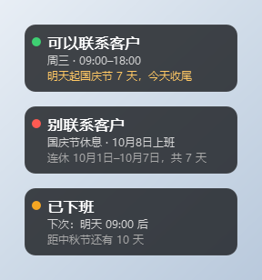
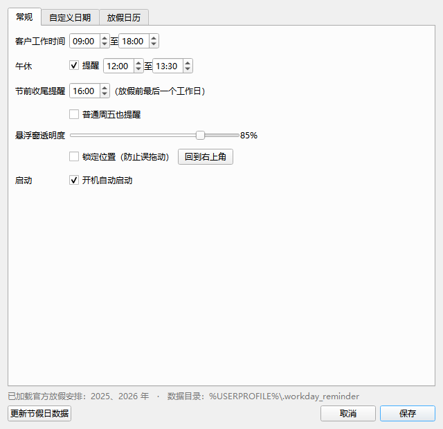
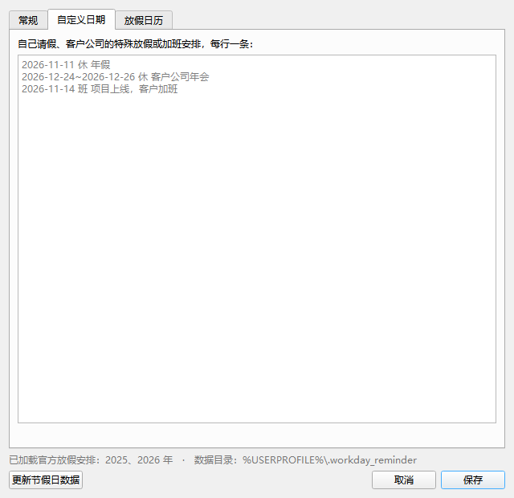
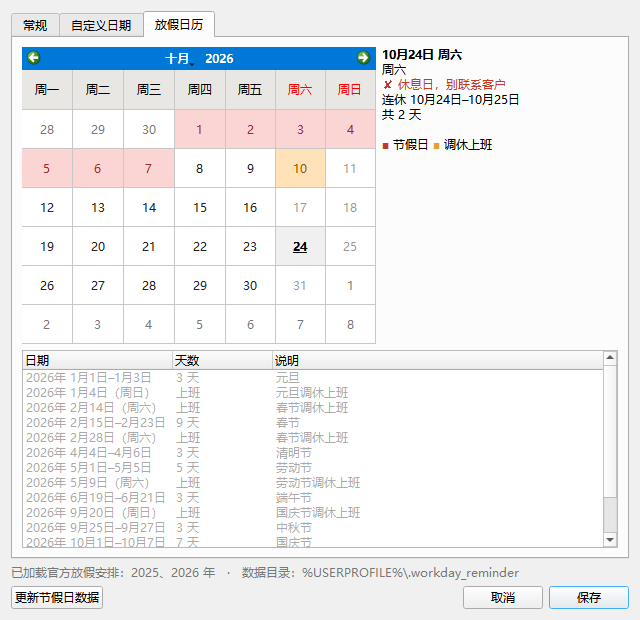

# 工作日提醒器 · 用户使用文档

本文面向**日常使用**这个程序的人：怎么读悬浮窗、每个设置项是什么意思、自定义日期怎么写、什么时候会收到提醒、遇到问题怎么办。

如果你要自己从源码运行或打包发布，请看[部署文档](deployment.md)。

---

## 目录

1. [认识这个程序](#1-认识这个程序)
2. [安装与第一次启动](#2-安装与第一次启动)
3. [读懂悬浮窗](#3-读懂悬浮窗)
4. [基本操作](#4-基本操作)
5. [设置详解](#5-设置详解)
6. [会收到哪些提醒](#6-会收到哪些提醒)
7. [日期性质是怎么判断的](#7-日期性质是怎么判断的)
8. [节假日数据从哪来、怎么更新](#8-节假日数据从哪来怎么更新)
9. [文件位置、备份与重置](#9-文件位置备份与重置)
10. [常见问题](#10-常见问题)
11. [使用小技巧](#11-使用小技巧)
12. [卸载](#12-卸载)

---

## 1. 认识这个程序

工作日提醒器的唯一目标：**别在客户休息的时候打扰客户，也别在该联系的时候自己漏掉。**

它常驻在你屏幕右上角，是一个半透明的小窗。窗口里的结论只有三种：可以联系、等一下、别联系。程序在后台按分钟级刷新状态，并在几个关键时间点弹出系统通知。

它判断一天的依据依次是：

1. 你自己在「自定义日期」里写的安排（最高优先级）；
2. 国务院办公厅公布的法定节假日与调休上班日；
3. 周六、周日；
4. 上面都不符合，就是普通工作日。

再叠加你在设置里填的**客户工作时间**和**午休时间**，得出"现在能不能联系"。

> 程序固定使用**北京时间（UTC+8）**判断，中国没有夏令时，所以不受你电脑所在时区影响。出差到国外时，它显示的仍然是国内客户的时间。

## 2. 安装与第一次启动

### 2.1 使用免安装版（Windows）

1. 从 [Releases](https://github.com/Delusionx1/WorkdayReminder/releases) 下载 `WorkdayReminder.exe`；
2. 放到一个固定的目录，例如 `D:\Tools\WorkdayReminder\WorkdayReminder.exe`。
   **不要**放在"下载"文件夹、桌面临时目录或同步盘的临时目录里——exe 换个位置，开机自启的路径也要跟着变（程序会尝试自动修正，但放固定位置最省事）；
3. 双击运行。约 1 秒后，右上角出现悬浮窗，托盘出现圆形图标。

首次启动会弹出一条欢迎通知，告诉你悬浮窗在哪里、怎么打开设置。

### 2.2 使用源码运行

适合 macOS、Linux 用户，或想改代码的人：

```bash
git clone https://github.com/Delusionx1/WorkdayReminder.git
cd WorkdayReminder
python -m venv .venv

# Windows
.venv\Scripts\activate
# macOS / Linux
source .venv/bin/activate

pip install -r requirements.txt
python main.py
```

想不弹出黑色命令行窗口，Windows 下用 `pythonw main.py` 启动，macOS / Linux 用 `nohup python main.py &` 之类的方式放到后台。

### 2.3 首次启动后建议做三件事

1. **双击悬浮窗**打开设置；
2. 把「客户工作时间」改成你客户真正的作息（默认 09:00–18:00）；
3. 需要的话勾上「开机自动启动」，以后就不用管了。

## 3. 读懂悬浮窗

悬浮窗固定三行文字，左边一个状态圆点：



| 区域 | 含义 |
| --- | --- |
| 左侧圆点 | 绿 = 可以联系，橙 = 暂时别联系（还没上班 / 午休 / 已下班），红 = 今天休息 |
| 第一行 | 结论：`可以联系客户` / `还没上班` / `午休中` / `已下班` / `别联系客户` |
| 第二行 | 原因与下一次可联系时间。工作日会显示 `周三 · 09:00–18:00`，休息日显示 `国庆节休息 · 10月8日上班`，调休上班日会标明 `春节调休上班` |
| 第三行 | 补充信息，可能为空：节前收尾提示、假期连休区间、下一个假期倒计时 |

三种状态的典型样式：

| 状态 | 第一行 | 第二行 | 第三行 |
| --- | --- | --- | --- |
| 可联系 | 可以联系客户 | 周三 · 09:00–18:00 | 距中秋节还有 10 天 |
| 节前最后一天 | 可以联系客户 | 周三 · 09:00–18:00 | 明天起国庆节 7 天，今天收尾 |
| 假期中 | 别联系客户 | 国庆节休息 · 10月8日上班 | 连休 10月1日–10月7日，共 7 天 |
| 已下班 | 已下班 | 下次：明天 09:00 后 | 距中秋节还有 10 天 |
| 午休 | 午休中 | 周四 · 13:30 后再联系 | 距国庆节还有 16 天 |

第三行的颜色也有讲究：**橙色**表示需要你注意（今天该收尾、某年数据没加载），灰色表示只是普通信息。

把鼠标移到悬浮窗上，它会变成完全不透明，方便看清；移开恢复你设置的透明度。鼠标悬停 >1 秒还会出现提示气泡，里面是完整的说明文字。

## 4. 基本操作

| 操作 | 效果 |
| --- | --- |
| **左键拖动** | 移动悬浮窗到任意位置，位置会被记住 |
| **双击悬浮窗** | 打开设置窗口（这是最常用的入口） |
| **右键悬浮窗** | 弹出菜单：当前状态说明、设置…、隐藏悬浮窗、退出 |
| **单击托盘图标** | 悬浮窗被隐藏时重新显示它 |
| **双击托盘图标** | 打开设置 |
| **右键托盘图标** | 同一个菜单 |

关于托盘图标：它是个圆形色块，中间写着 **班**（绿，可以联系）、**等**（橙，等一下）、**休**（红，今天休息）。Windows 上它可能被折叠进"隐藏的图标"区域，从任务栏箭头里拖出来固定即可。

**单实例**：程序已经在运行时再次双击，不会开出第二个悬浮窗，而是直接弹出正在运行的那个实例的设置窗口。所以"双击没反应"通常意味着"设置窗口已经在屏幕上"——检查一下是不是被别的窗口挡住了。

## 5. 设置详解

设置窗口有三个标签页：**常规**、**自定义日期**、**放假日历**。

### 5.1 常规



| 设置项 | 默认值 | 说明 |
| --- | --- | --- |
| 客户工作时间 | 09:00 – 18:00 | 判断"还没上班 / 可以联系 / 已下班"的分界线，也是早间提醒的触发时刻。建议按**客户**的作息填，而不是你自己的 |
| 午休 + 时间段 | 开启，12:00 – 13:30 | 勾选"提醒"后，工作时间内落在午休区间会显示"午休中"。客户没有午休习惯就取消勾选 |
| 节前收尾提醒 | 16:00 | 放假前最后一个工作日的这个时刻，提醒你把需要客户确认的事处理完。设为 16:00 意味着"还有两小时下班" |
| 普通周五也提醒 | 不勾选 | 勾选后，只要明天不上班（包括普通周末），就在上面的时间提醒，适合每周都要发周报/对账的场景 |
| 悬浮窗透明度 | 85% | 30%–100%，拖动滑块时悬浮窗会实时改变，方便预览 |
| 锁定位置 | 不勾选 | 勾选后左键拖动失效，防止误拖。双击和右键仍然可用 |
| 回到右上角 | — | 悬浮窗跑到屏幕外或位置乱了时，点一下回到右上角，同时清除保存的坐标 |
| 开机自动启动 | 不勾选 | 见[部署文档的自启原理](deployment.md#7-开机自启的实现)一节 |

保存后立即生效，不需要重启程序。"取消"会放弃本页和自定义日期页的修改（透明度预览也会还原）。

### 5.2 自定义日期



用来处理"国家放假安排之外"的例外。**每行一条**，格式：

```text
日期或日期范围 休|班 说明
```

| 部分 | 说明 |
| --- | --- |
| 日期 | `2026-11-11` 这样的 `年-月-日`，必须完整 |
| 日期范围 | `2026-12-24~2026-12-26`，最大 60 天（也接受全角 `～`） |
| 休 / 班 | `休` = 当天休息、别联系客户；`班` = 当天上班、可以联系 |
| 说明 | 可选，显示在悬浮窗和日历上。不写就是"自定义休息 / 自定义上班" |

以 `#` 开头的行和空行会被忽略，可以拿来写注释。示例：

```text
# 我自己的年假
2026-11-11 休 年假
2026-11-12~2026-11-13 休 年假

# 客户那边的安排
2026-12-24~2026-12-26 休 客户公司年会
2026-11-14 班 项目上线，客户加班
```

几个要点：

- **优先级最高**：写了 `休` 的日期，即使国务院安排上班（调休），也按休息处理；写了 `班` 的周末按上班处理。
- 自定义的 `休` 会参与"连休区间""节前收尾""假期结束恢复上班"的判断，效果和法定节假日一样。
- 任意一行格式错误时，**保存会被阻止**，错误行号和内容会显示在输入框下方，改完再保存。这是为了避免你写错一天却以为已经生效。
- 日期范围不要超过 60 天；超过请拆成多行。

### 5.3 放假日历



- **日历区**：颜色对应日期性质——深红底 = 法定节假日，紫底 = 你标注的自定义休假，橙底 = 调休上班，蓝底 = 你标注的自定义上班，灰色字 = 普通周末，黑色字 = 普通工作日。今天加粗并带下划线。
- **右侧说明**：选中某一天，显示它是上班还是休息、连休几天、从哪天到哪天。
- **下方清单**：从今年 1 月 1 日列到明年 12 月 31 日的所有假期和调休上班日，打开时自动滚动到"下一个"假期；已经过去的行是灰色的。
- 如果次年的安排还没公布，清单最后会有一行橙色提示。
- 最底下显示"已加载官方放假安排：2025、2026 年"和本机数据目录，旁边是 **更新节假日数据** 按钮。

## 6. 会收到哪些提醒

除了悬浮窗的实时状态，程序会在四个时间点弹系统通知。所有提醒**每个自然日最多一次**，通知停留约 15 秒（系统可能缩短）。

| 时机 | 触发条件 | 通知内容 |
| --- | --- | --- |
| 假期第一天 | 今天是法定节假日（或你标注的休假）的休息日 | 今天休息（春节）：不要联系客户。2月24日（周二）恢复上班 |
| 调休上班日 | 到了"客户工作时间"的开始时刻 | 今天春节调休上班：别当成周末——客户今天正常上班，可以联系 |
| 假期结束 | 到了工作时间，且昨天是节假日 | 假期结束，客户恢复上班：可以跟进假期前没处理完的事项了 |
| 节前收尾 | 到了"节前收尾提醒"时间，且明天休息（法定节假日，或勾选了"普通周五也提醒"的周末） | 明天起放假：国庆节、中秋节，10月1日–10月8日 共 8 天。需要客户确认/回复的事，今天下班前处理完 |

细节说明：

- 程序**只在运行时**提醒。如果触发时刻电脑关机或程序没开，当天的提醒会在你下次打开程序时补发（因为判断的是"现在是否已经过了那个时间点"）；但如果一整天都没开，就收不到。
- 悬浮窗本身每 30 秒刷新一次，跨天时自动重新判断并刷新节假日数据。
- 如果你只想要通知、不想要悬浮窗，可以右键托盘 → 隐藏悬浮窗。悬浮窗隐藏后托盘图标和通知照常工作。
- 点击通知一般会聚焦到程序；Windows 的通知集中在右下角通知中心，错过了可以从那里翻。

## 7. 日期性质是怎么判断的

程序对任意一天的判定顺序（**自上而下，命中即停**）：

| 顺序 | 条件 | 结论 | 悬浮窗标注 |
| --- | --- | --- | --- |
| 1 | 在「自定义日期」里标注了 `休` | 休息 | 你写的说明 |
| 2 | 在「自定义日期」里标注了 `班` | 上班 | 你写的说明 |
| 3 | 在国务院放假安排里，是放假日期 | 休息 | 春节、国庆节…… |
| 4 | 在国务院放假安排里，是调休上班日 | 上班 | 春节调休上班 |
| 5 | 周六或周日 | 休息 | 周六 / 周日 |
| 6 | 其他 | 上班 | 工作日 |

"现在能不能联系"则是在"今天是上班日"的基础上，再看当前时刻：

```
今天休息 ──────────────────────────────→ 别联系客户（红色）
今天上班，现在 < 上班时间 ──────────────→ 还没上班（橙色）
今天上班，现在 ≥ 下班时间 ──────────────→ 已下班（橙色）
今天上班，上班时间内，且落在午休 ──────→ 午休中（橙色）
今天上班，上班时间内，不在午休 ────────→ 可以联系客户（绿色）
```

边界值：正好到上班时间算"可以联系"；正好到下班时间算"已下班"；正好到午休开始算"午休中"，正好到午休结束算"可以联系"。

## 8. 节假日数据从哪来、怎么更新

| 数据 | 来源 |
| --- | --- |
| 2025、2026 年放假安排 | 已经编译进程序（国务院办公厅公告） |
| 之后年份 | 启动后自动从 [holiday-cn](https://github.com/NateScarlet/holiday-cn) 下载 |

自动更新的时机：

- 程序启动约 2 秒后；
- 每次跨天（零点后第一次刷新）时；
- 你在设置里点「更新节假日数据」时。

每次都尝试获取**当年和次年**的数据，依次尝试三个镜像地址：

1. `cdn.jsdelivr.net`
2. `fastly.jsdelivr.net`
3. `raw.githubusercontent.com`

单个地址 8 秒超时，取到就停。成功的数据会缓存到 `~/.workday_reminder/holiday_cn_YYYY.json`，下次启动直接读缓存，**断网也能用**。

常见情况：

- **次年的安排还没公布**：每年 11 月前后国务院才发通知。在此之前程序会提示"20XX 年放假安排尚未公布"，属于正常现象，公布后联网自动补上。
- **完全离线**：内置数据 + 本地缓存仍然工作；只有跨到一个从没下载过的年份时，才需要联网一次（或按[部署文档](deployment.md#10-离线与内网部署)手工放入 JSON 文件）。
- **公司/客户的实际安排和国务院不一样**：用「自定义日期」覆盖，不要依赖联网数据。

## 9. 文件位置、备份与重置

| 位置 | 内容 |
| --- | --- |
| `%USERPROFILE%\.workday_reminder\settings.ini` | 全部设置，包括窗口位置和自定义日期 |
| `%USERPROFILE%\.workday_reminder\holiday_cn_YYYY.json` | 下载到的年度放假安排缓存 |

macOS / Linux 下 `~` 就是你的用户主目录。

- **备份 / 换电脑**：退出程序，复制整个 `.workday_reminder` 文件夹到新机器的同一位置即可。
- **恢复默认设置**：退出程序，删掉 `settings.ini`（或整个文件夹），重新启动。
- **想直接改配置**：`settings.ini` 是标准 INI 文件，键名含义见[部署文档的配置键表](deployment.md#8-配置键参考)，但需在程序退出后修改。

## 10. 常见问题

### 悬浮窗不见了

先看托盘：单击托盘图标即可重新显示（如果它处于隐藏状态）。如果没有托盘图标，说明系统托盘不可用或图标被折叠了，从任务栏的"隐藏的图标"里找。

如果程序根本没在运行（任务管理器里看不到 `WorkdayReminder.exe` / `python.exe`），重新启动一次。

### 托盘图标找不到 / 没有托盘图标

Windows 会把不常用的托盘图标折叠起来；Win11 在"设置 → 个性化 → 任务栏 → 其他系统托盘图标"里可以打开。少数精简系统或某些 Linux 桌面没有系统托盘，此时程序仍会显示悬浮窗，通知改用普通弹窗。

### 没有收到提醒

按顺序检查：

1. 程序当时在运行吗？（提醒不会在你没开程序时凭空出现）
2. 今天是不是已经有提醒发过了？同一天同一种提醒只弹一次。
3. 触发条件不满足：比如今天是普通工作日，那本来就没有提醒；或者"节前收尾提醒"时间还没到。
4. Windows 是否开启了"专注助手 / 勿扰模式"，把通知拦截了。

### 悬浮窗显示的时间和我电脑不一致

这是有意设计：程序始终按**北京时间**判断，不读系统时区。你人在国外时，它显示的是国内客户的作息。

### 客户公司的作息和我们不一样

两件事分开处理：

- **时间不同**（比如客户 10 点才上班）：改「常规」里的客户工作时间；
- **日期不同**（比如客户年会放假、某个周末加班）：用「自定义日期」。

程序同一时间只维护一套时间设置，如果你的客户横跨两套作息，建议按"最保守"的一套填，再用自定义日期补例外。

### 明年 / 后年的放假安排没有

国务院通常在**每年 11 月前后**公布次年安排，公布后程序联网会自动获取。也可以打开设置点「更新节假日数据」。如果公司网络访问不了上面三个地址，按[离线部署说明](deployment.md#10-离线与内网部署)手工放数据文件。

### 开机没有自动启动

1. 设置里确认「开机自动启动」已勾选，保存；
2. 程序被移动过目录时，启动项里的旧路径会失效——**手动运行一次新位置的程序**，它会自动把启动项改成当前路径；
3. Windows 的"任务管理器 → 启动应用"里如果这一项被"禁用"，需要手动启用（部分安全软件也会拦截注册表启动项）。

### exe 被杀毒软件拦截 / 提示未知发布者

未做代码签名的 PyInstaller 单文件程序常被启发式扫描误报。处理方式：把程序目录加入信任列表；或者干脆从源码运行（`python main.py`）。程序没有任何联网上传行为，除节假日 JSON 外没有任何网络请求。

### 悬浮窗跑到屏幕外了

打开设置 → 常规 → 「回到右上角」。程序在启动时会校验保存的坐标是否还在某个显示器范围内，跑出界会自动回到默认位置。

### 双击悬浮窗没有弹出设置

先检查是不是设置窗口已经打开了但被压在别的窗口后面（设置窗口也置顶，但可能被全屏程序盖住）。另外，重复双击 exe 启动程序时，只会弹出已有实例的设置，不会再出现第二个悬浮窗。

### 换电脑 / 重装系统后设置丢了

设置保存在本机用户目录，不会同步。把旧的 `.workday_reminder` 文件夹复制过来即可，见[第 9 节](#9-文件位置备份与重置)。

## 11. 使用小技巧

- **提前录入年假**：请好假当天就写进去，之后悬浮窗会自动把这段时间标成休息，节前收尾提醒也会自动跳过。
- **把客户年会写进去**：`2026-12-24~2026-12-26 休 客户公司年会`，那几天不会误发消息。
- **项目上线的周末**：`2026-11-14 班 项目上线`，防止程序告诉你"别联系客户"而错过窗口期。
- **锁定位置防误拖**：悬浮窗贴边放置时容易拖到，勾上「锁定位置」。
- **只看托盘**：把透明度调到 30% 或直接隐藏悬浮窗，靠托盘图标颜色（班 / 等 / 休）判断，安静很多。
- **节前收尾时间**：如果你的客户 17:30 就下班，把提醒调到 15:00，留出处理时间。

## 12. 卸载

1. 右键托盘图标 → **退出**（或右键悬浮窗 → 退出）；
2. 打开设置取消勾选「开机自动启动」并保存（也可以退出前先取消）；
3. 删除程序文件（`WorkdayReminder.exe` 或源码目录）；
4. 删除 `%USERPROFILE%\.workday_reminder` 文件夹；
5. 若仍残留启动项，可在 `regedit` 里删除 `HKEY_CURRENT_USER\Software\Microsoft\Windows\CurrentVersion\Run` 下的 `WorkdayReminder`，或执行：

```powershell
reg delete "HKCU\Software\Microsoft\Windows\CurrentVersion\Run" /v WorkdayReminder /f
```

macOS 上对应删除 `~/Library/LaunchAgents/com.workday.reminder.plist`；Linux 上删除 `~/.config/autostart/workday-reminder.desktop`。

---

[← 返回 README](../README.md)　·　[部署文档 →](deployment.md)
